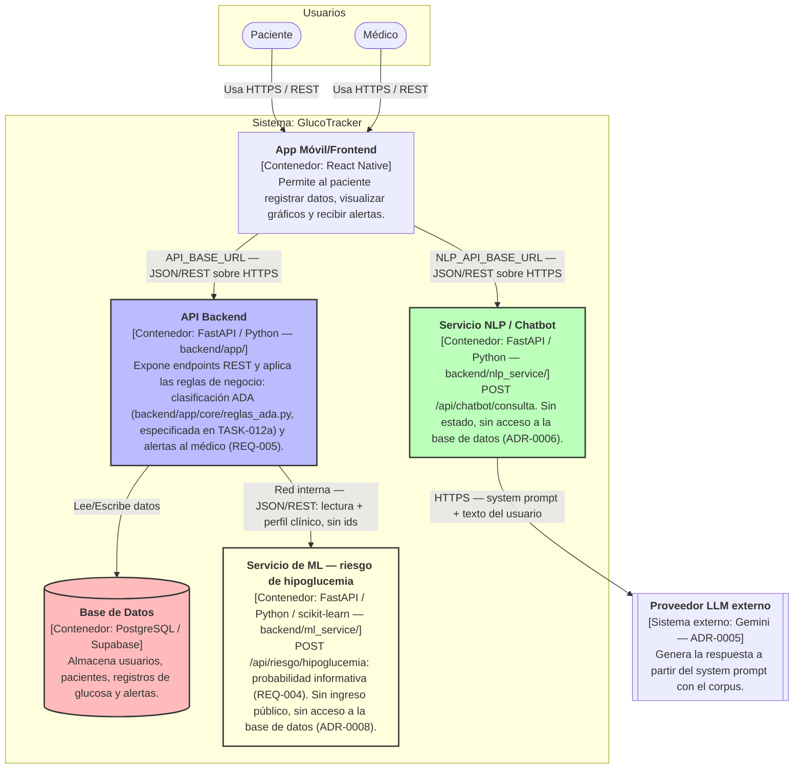

# C4 - Nivel 2: Diagrama de Contenedores (GlucoTracker)

El siguiente diagrama detalla los contenedores de software que componen la arquitectura de GlucoTracker.

- **Servicio NLP:** es un contenedor separado del API Backend (ADR-0006). La app lo llama directo, sin pasarela, y él es el único que habla con el proveedor LLM externo. No llama al API Backend ni a la base de datos.
- **Servicio de ML:** es un contenedor separado del API Backend (ADR-0008). **Solo el API Backend lo llama**, por red interna. La app no lo llama, no tiene ingreso público ni autenticación propia en v1 (ver la Open Question de design.md), y no accede a la base de datos. Su probabilidad es informativa y no dispara alertas: las alertas salen de la clasificación ADA del API Backend. Su código vive solo en `backend/ml_service/`; el API Backend no contiene código de ML. El modelo es experimental y su probabilidad se muestra únicamente al médico.