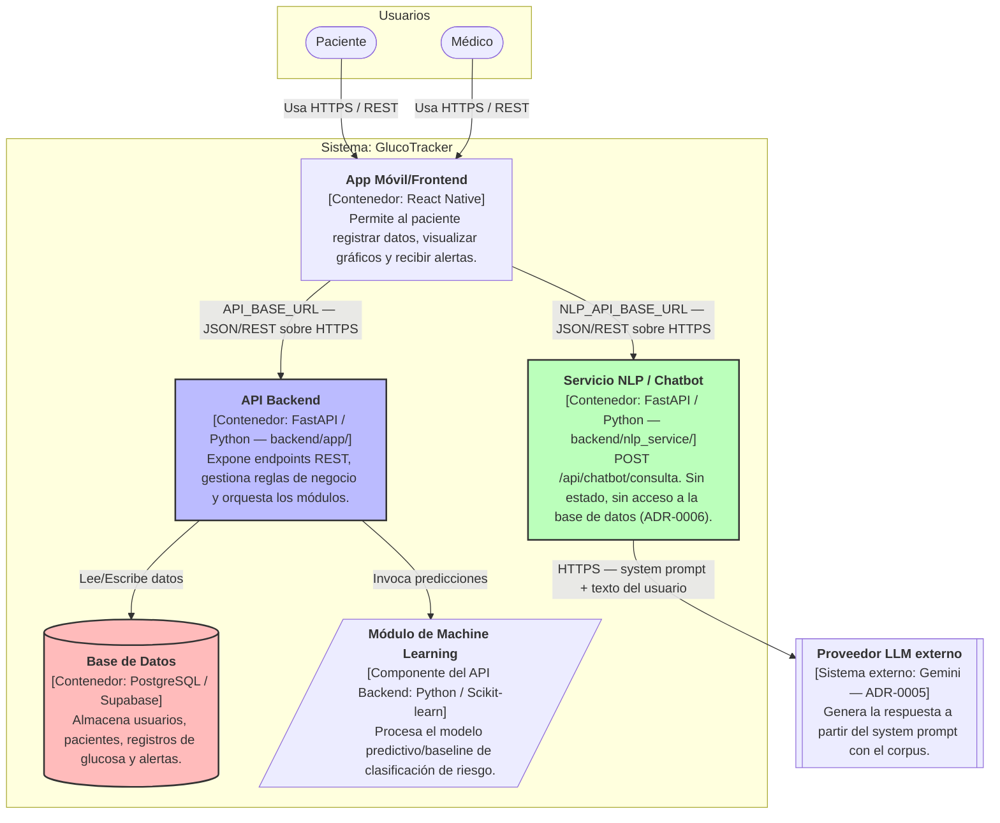

# C4 - Nivel 2: Diagrama de Contenedores (GlucoTracker)

El siguiente diagrama detalla los contenedores de software que componen la arquitectura de GlucoTracker.

El servicio NLP es un contenedor separado del API Backend (ADR-0006). La app lo llama directo, sin pasarela, y él es el único que habla con el proveedor LLM externo. No llama al API Backend ni a la base de datos.