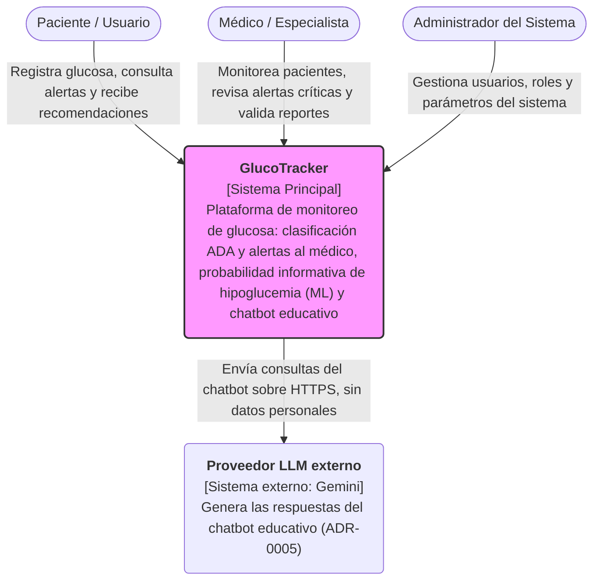

# C4 - Nivel 1: Diagrama de Contexto del Sistema (GlucoTracker)

El siguiente diagrama muestra el contexto del sistema GlucoTracker y cómo interactúa con los diferentes usuarios y actores externos.

A este nivel, el servicio de ML es parte interna de GlucoTracker y no un sistema externo: no tiene ingreso público y solo lo llama el backend (ADR-0008). Su detalle está en el diagrama de contenedores (`c4_container.md`). El único sistema externo es el proveedor LLM del chatbot.